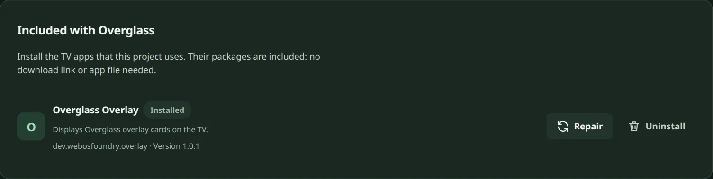
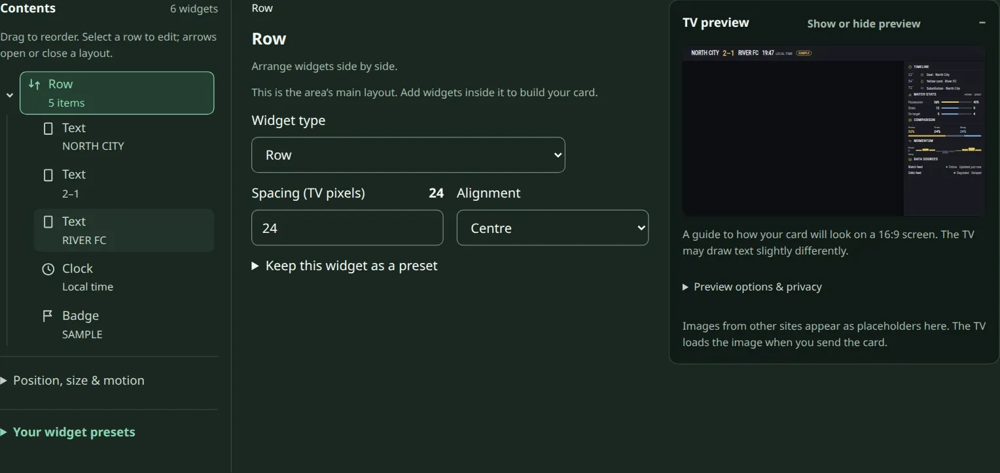

<h1 align="center">
<picture>
  <source media="(prefers-color-scheme: dark)" srcset="assets/banner-dark.svg">
  <source media="(prefers-color-scheme: light)" srcset="assets/banner-light.svg">
  
</picture>
</h1>

<p align="center">Control an already-rooted LG webOS TV from a browser, the <code>wof</code> CLI, an HTTP API, or Home Assistant.</p>

<p align="center">
  <a href="https://github.com/Osyna/Overglass/releases"></a>
  <a href="https://github.com/Osyna/Overglass/actions/workflows/ci.yml"></a>
  <a href="LICENSE"></a>
</p>


<p align="center"><sub>Animated demo of the actual overlay renderer: sample scoreboard, stats, ticker and kickoff card. Match data is illustrative. The 3840 × 2160 photo is by <a href="https://www.pexels.com/photo/exciting-soccer-match-in-abu-dhabi-stadium-31163019/">Eslam Mohammed Abdelmaksoud</a> on <a href="https://www.pexels.com/license/">Pexels</a>.</sub></p>

[MIT license](LICENSE) · [Setup](docs/INSTALL.md) · [API](docs/API.md) · [Home Assistant](docs/HOME-ASSISTANT.md)

## Features

- Build TV overlay cards in the visual editor or paste JSON from your editor or an LLM.
- Install or repair the included overlay renderer from Apps, without finding an `.ipk` file or download URL.
- Control navigation, HDMI input, volume, and mute from Remote.
- Use the CLI, HTTP API, and Home Assistant integration for automation.
- Run the web UI on a computer or install its server on the TV.

## Requirements

The TV must already be rooted and reachable over SSH. This project does not root it.
You need the TV's existing root SSH key for initial pairing.

On the computer used for setup: Python 3.9 or newer, `ssh`, and `ssh-keygen`.
The core package has no required Python dependencies.

## Install

### Release package

Download `webos_foundry-0.1.0-py3-none-any.whl` from [Releases](https://github.com/Osyna/Overglass/releases).
Install it in a virtual environment:

```sh
python3 -m venv .venv
. .venv/bin/activate
python -m pip install ./webos_foundry-0.1.0-py3-none-any.whl
wof --help
wof serve
```

The release also includes a portable web/CLI source ZIP and TV app IPK.

For the portable web UI and CLI, extract `Overglass-0.1.0.zip` and run:

```sh
unzip Overglass-0.1.0.zip
cd Overglass-0.1.0
python3 -m webos_foundry.cli --help
python3 -m webos_foundry.server
```

### From source

Clone the repository and install from source:

```sh
git clone https://github.com/Osyna/Overglass.git
cd Overglass
python3 -m venv .venv
. .venv/bin/activate
python -m pip install -e .
wof --help
wof serve
```

Keep the checkout available when using an editable install.

## Use the web UI

### Connect the TV

Open `http://127.0.0.1:8765/` on the computer running the server.
Choose Connect, enter the TV's address, and select its existing root SSH key.
Pairing creates a restricted project key for subsequent TV commands.

### Install the included TV app

Open **Apps → Included with Overglass**.
Choose **Install on TV**, or **Repair** if the renderer is already installed.
The page shows success only after the TV confirms installation, and displays installation errors.

The included app is `dev.webosfoundry.overlay`. It displays the JSON cards on the TV.
Sending another design does not require reinstalling it.



### Make an overlay

Open Show, choose a starting design, and edit its widgets or import JSON.
Preview the card, then choose Send to TV.
The overlay app must be installed before the TV can display the card.



### Run without a computer left on

After pairing, install the on-TV web server:

```sh
wof install --tv-server
```

Open the TV's network address on port `8766`.
This also stages the bundled overlay package, so its Install/Repair action works without a running PC server.
See [on-TV setup and authentication](docs/TV-SERVER.md).

## CLI and API usage

```sh
wof status --json
wof remote volume 20
wof overlay show --title Dinner --body "It is ready."
curl --fail http://127.0.0.1:8765/api/apps/bundled
```

`GET /api` lists the running server's routes and capabilities.
See the [CLI reference](docs/CLI.md) and [API reference](docs/API.md) for arguments and authentication.

## Configuration and security

Configuration is stored in `~/.config/webos-foundry/`; `WEBOS_FOUNDRY_HOME` selects another directory.
Keep its keys and credentials out of Git.
Use the server's authentication controls for network access, and keep it on a trusted network rather than exposing it to the Internet.

Overglass keeps the existing `wof` CLI and `webos-foundry` Python distribution
(`webos_foundry` module/Home Assistant domain), `WEBOS_FOUNDRY_*` environment variables,
configuration paths, and TV app IDs. Renaming the project does not require re-pairing
the TV or migrating saved designs.

Read the [safety notes](docs/SAFETY.md) before uninstalling TV components, and [SECURITY.md](SECURITY.md) for vulnerability reporting.

## Development

Install the test dependencies, then run the backend and web checks:

```sh
python -m pip install pytest aiohttp voluptuous PyYAML jsonschema
python -m pytest tests/ -q
node web/check-ui.mjs
node web/check-overlay.mjs
node web/check-automate.mjs
node web/check-studio.mjs
```

The web checks require Node.js. Contributor setup and optional tools are documented in [CONTRIBUTING.md](CONTRIBUTING.md).

To record the CLI help walkthrough, run `vhs demo.tape` after installing the project.
It writes `assets/demo.gif`; that GIF is not included until it has actually been rendered.

## Documentation and contributing

- [Installation, Docker, and systemd](docs/INSTALL.md)
- [On-TV server](docs/TV-SERVER.md)
- [CLI](docs/CLI.md) and [HTTP API](docs/API.md)
- [Home Assistant integration](docs/HOME-ASSISTANT.md)
- [Architecture](ARCHITECTURE.md)
- [Contributing](CONTRIBUTING.md)

## License

MIT. See [LICENSE](LICENSE).
